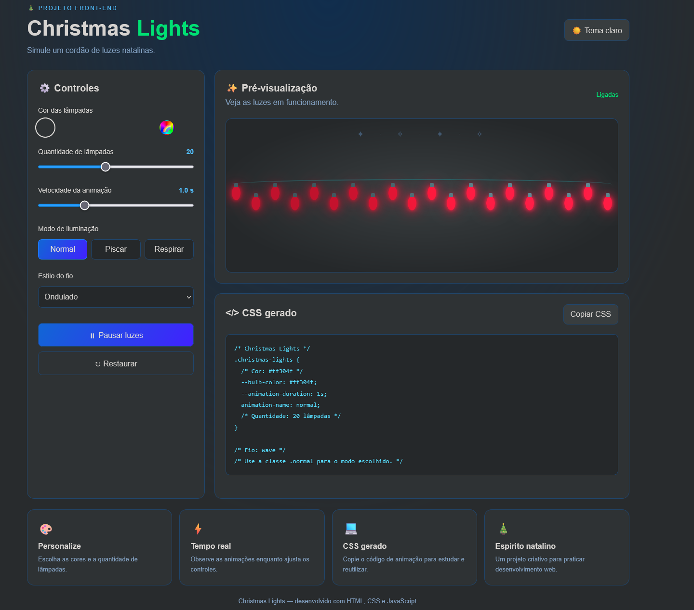

# 🎄 Christmas Lights

A simple and interactive Christmas Lights simulator built to practice web development fundamentals. The project simulates a string of colorful Christmas lights, creating a festive atmosphere with blinking and glowing effects.

## ✨ Features

- 🎄 **Colorful Lights:** Simulates a string of Christmas lights with multiple colors.
- 💡 **Blinking Animation:** Lights blink to create a realistic Christmas decoration effect.
- 🌈 **CSS Effects:** Uses colors, shadows, and transitions to create a glowing appearance.
- ▶️ **Interactive Experience:** Provides a simple and enjoyable visual simulation.
- 📱 **Responsive Design:** Adapts to different screen sizes.

## 🛠️ Technologies

- HTML5
- CSS3
- JavaScript

## 📸 Preview



## 🚀 Getting Started

### Prerequisites

You only need a modern web browser to run this project.

### Installation

1. Clone this repository:

   ```bash
   git clone https://github.com/Taunt-byte/Christmas-Lights.git
   ```

2. Navigate to the project directory:

   ```bash
   cd Christmas-Lights
   ```

3. Open the `index.html` file in your browser.

## 📂 Project Structure

```text
Christmas-Lights/
├── index.html
├── style.css
└── script.js
```

> Adjust the folder structure to match your actual project files.

## 🎯 Project Goals

This project was created as a web development practice exercise to improve my skills in:

- HTML page structure.
- CSS animations and visual effects.
- JavaScript fundamentals.
- DOM manipulation.
- Responsive web design.

## 🔮 Future Improvements

- [ ] Add different blinking patterns.
- [ ] Add a button to turn the lights on and off.
- [ ] Add a button to change the lights' colors.
- [ ] Create multiple animation modes.
- [ ] Add background music or festive sound effects.
- [ ] Improve accessibility and mobile responsiveness.

## 📚 Inspiration

This project is inspired by the **Christmas Lights** challenge from [App Ideas](https://github.com/florinpop17/app-ideas), a collection of projects designed to help developers practice programming.

## 👨‍💻 Author

**Lucas Neves**

- GitHub: [@YOUR-USERNAME](https://github.com/YOUR-USERNAME)

---

⭐ If you like this project, consider giving the repository a star!

**Made with ❤️ and a Christmas spirit! 🎅🎄**
